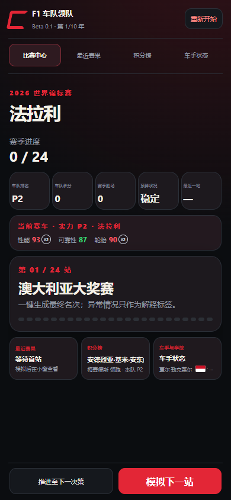

# F1 车队领队 · 游戏设计作品集

一款围绕“做决定，见证车队命运”展开的轻量经营游戏。玩家扮演车队领队，从阵容与研发选择出发，推进赛季，在关键时刻做出取舍，并见证车手与车队在多年中的变化。

本仓库是**作品展示**，包含项目背景、设计思路、开发历程、精选截图与独立制作的简化演示。完整游戏的源代码、数据与构建历史不在本仓库中。

## 项目概要

- **类型**：手机优先的浏览器经营模拟游戏
- **核心体验**：快速推进比赛；在关键节点做选择；用结果和反馈串起车队故事
- **完整作品**：十年生涯、跨赛季车手成长与阵容变化、车队研发、随机事件、赛季与生涯结算
- **主要技术**：HTML、CSS、JavaScript；通过结果级模拟生成比赛与赛季结果
- **项目角色**：GEORGE 主导玩法构思、规则、需求与迭代方向；开发过程中使用 AI 辅助实现、调试与测试

## 作品展示

比赛中心截图来自早期版本，用于展示迭代过程，并非当前界面。

更多截图可查看 [`screenshots/`](screenshots/)。

## 运行简化演示

打开 [`demo/index.html`](demo/index.html)，即可体验独立制作的小型经营决策示例。演示使用虚构数据与简化规则，并非完整游戏、完整引擎或原始数值模型；下载仓库后也可在浏览器离线打开。

## 设计与开发

- [设计思路与系统说明](docs/design-and-technology.md)
- [开发历程与验证记录](docs/development-process.md)

## 版权与声明

除另有说明外，本仓库的原创作品和代码版权归 GEORGE 所有。允许个人查看与试玩；未经许可，不得复制、修改、再发布或用于其他项目。此声明不能阻止公开内容被查看或按平台规则 fork。

本项目为非官方、非商业粉丝作品，与 Formula 1、FIA、车队及其他相关权利人无隶属或合作关系。涉及的现实名称及标识归其各自权利人所有。游戏评分和结果均为虚构设计。
