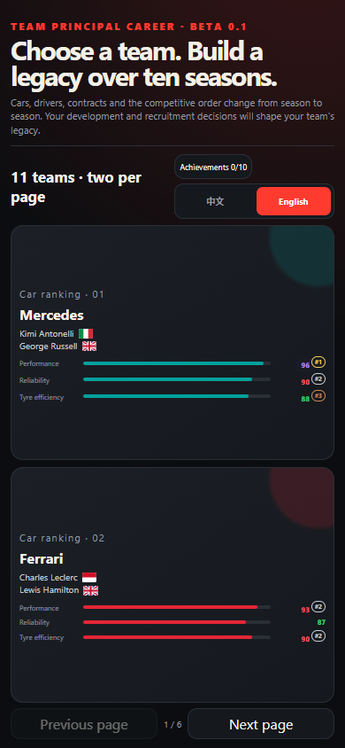
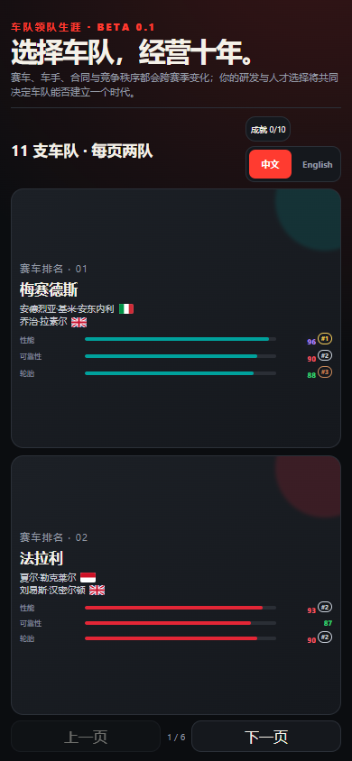
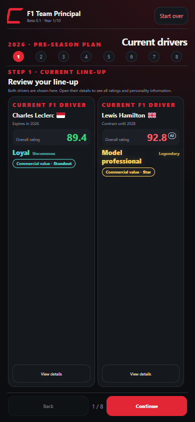
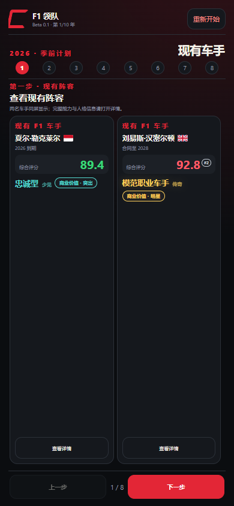
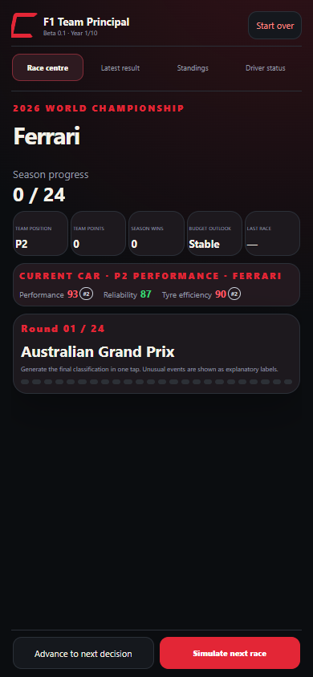
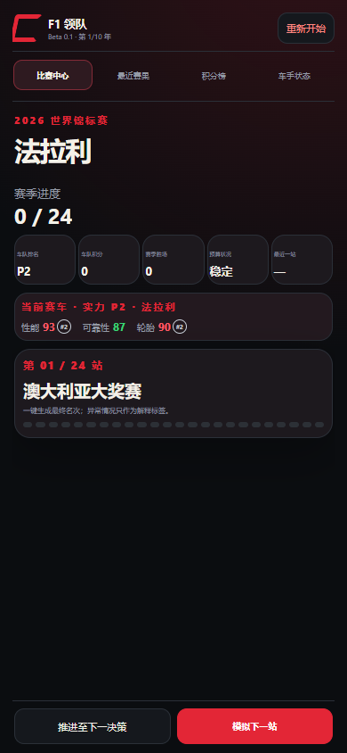
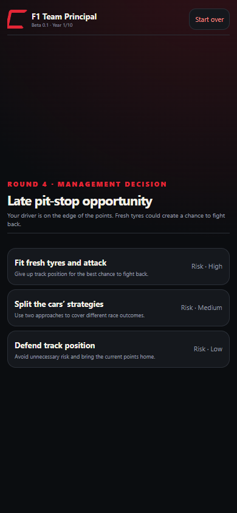
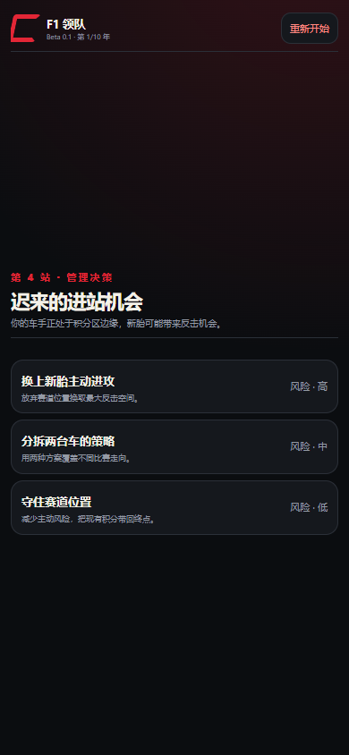
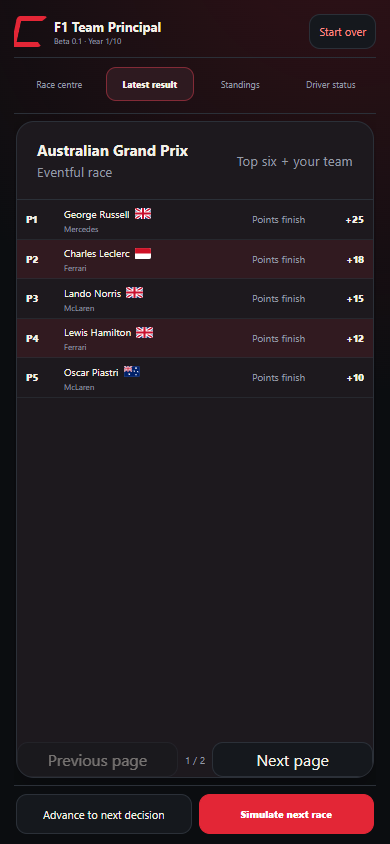
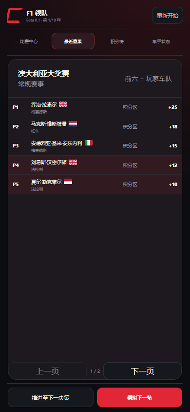

# F1 Team Principal / F1 车队领队

**A mobile-first motorsport management game about making decisions and shaping a team's future.** Choose a team, develop its car and drivers, navigate key moments, and see the consequences unfold across a ten-season career.

**一款手机优先的赛车经营游戏：通过决策，改变车队的未来。** 玩家选择车队、发展赛车与车手，在关键时刻作出取舍，并见证结果贯穿十年生涯。

This repository is a **portfolio**, not the complete game source. It contains selected screenshots, design and technical notes, development history and a separately created small playable demo. The complete game's source, data and development history are not included.

本仓库用于**作品展示**，包含精选截图、设计与技术说明、开发历程和独立制作的简化演示；不包含完整游戏的源代码、数据与开发历史。

## At a glance / 项目概览

| | |
|---|---|
| Experience / 核心体验 | Fast season simulation, meaningful management decisions and emerging stories / 快速推进赛季、作出经营决策，并通过结果形成故事 |
| Full game / 完整作品 | Ten seasons, driver development and contracts, recruitment, car development, events and career review / 十年生涯、车手成长与合同、新人市场、赛车研发、随机事件和生涯总结 |
| Technology / 技术 | HTML, CSS and JavaScript; result-level simulation rather than lap-by-lap physics / 使用 HTML、CSS、JavaScript，以结果级模拟替代逐圈物理模拟 |
| Role / 分工 | GEORGE led the concept, rules, requirements and iteration; AI assisted implementation, debugging and testing / GEORGE 主导玩法构思、规则、需求和迭代方向；AI 辅助实现、调试与测试 |

## Screenshots / 游戏截图

The screenshots show the complete game's offline bilingual version. English and Chinese images are separate sample runs, so simulated results may differ.

以下截图来自完整游戏的离线双语版。中英文截图分别从不同的模拟中截取，因此赛果可能不同。

| Screen / 页面 | English | 中文 |
|---|---|---|
| Choose a team / 选择车队 |  |  |
| Review the line-up / 查看现有阵容 |  |  |
| Race centre / 比赛中心 |  |  |
| Make a race decision / 比赛决策 |  |  |
| Review the result / 查看赛果 |  |  |

## Try the small demo / 体验简化演示

Open [demo/index.html](demo/index.html) locally after downloading the repository. This independent bilingual example uses fictional data and simplified rules to demonstrate one management choice and its outcome; it is **not** the complete game or the original simulation engine. GitHub's file view displays source rather than running the game.

下载仓库后在浏览器中打开 [demo/index.html](demo/index.html)，即可离线体验一个管理决策及其结果。演示支持中英文，使用虚构数据和简化规则，**不是**完整游戏或原始模拟引擎。GitHub 文件页面展示的是源码，并不会直接运行游戏。

## Explore the project / 了解项目

- [Design and technology / 设计思路与系统说明](docs/design-and-technology.md)
- [Development and validation / 开发历程与验证记录](docs/development-process.md)

## Copyright and notice / 版权与声明

Unless otherwise stated, original content and code in this repository are copyright © GEORGE. Personal viewing and play are permitted; copying, modifying, redistributing or using them in another project requires permission. Public content can still be viewed or forked under GitHub's rules.

除另有说明外，本仓库的原创内容与代码版权归 GEORGE 所有。允许个人查看和试玩；复制、修改、再发布或用于其他项目须事先获得许可。公开内容仍可按照 GitHub 规则被查看或 fork。

This is an unofficial, non-commercial fan project, unaffiliated with Formula 1, the FIA, teams or other rights holders. Third-party names and marks belong to their respective owners. Ratings and outcomes are fictional game design.

本项目是非官方、非商业粉丝作品，与 Formula 1、FIA、车队及其他权利人无隶属或合作关系。相关名称与标识归其各自权利人所有；游戏评分和结果均为虚构设计。
